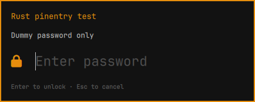

# pinentry-omarchy



A Quickshell password prompt with a Rust Assuan backend and native locked-memory password field for rbw. QML draws the Omarchy-themed chrome but never receives the accumulated password. A thin C++ Qt plugin binds the native field to Rust; there is no Python dependency. Does not modify or restart Omarchy's shell.

Requires Quickshell, Hyprland, and the JetBrainsMono Nerd Font; Rust/Cargo, make, qmake6, Qt6 Quick headers, and a C++ compiler to build. Run from a Wayland desktop session with `XDG_RUNTIME_DIR` set.

## Build

```sh
bin/build
```

Keep the development executable beside `shell.qml` and `qml/`. This checkout is for development and preview; use the root-owned package for normal password entry.

## Package

```sh
bin/package
```

The local `pkgbuild/PKGBUILD` builds from this checkout. `bin/package` runs makepkg in that directory, keeping makepkg's disposable `src/` separate from Rust's real `src/`. Install the resulting package with your package manager. If Rust is supplied by mise rather than Arch's package database, `bin/package --nodeps` uses the existing toolchain; first verify that the listed runtime/build dependencies are present. Packaging installs `/usr/bin/pinentry-omarchy` and root-owned UI code under `/usr/lib/pinentry-omarchy/`. It does not change rbw automatically.

## Preview

```sh
./pinentry-omarchy --preview
```

The preview discards its response. Never enter a real password in a preview.

## Enable for rbw

```sh
rbw config set pinentry /usr/bin/pinentry-omarchy
```

Restore the default with `rbw config set pinentry pinentry`. This project does not change GPG configuration.

## Controls

| Key | Action |
| --- | --- |
| Enter | Submit / move to repeat field |
| Escape | Cancel |
| Tab | Switch password/repeat fields |
| Arrows, Home, End | Move within the password |
| Backspace, Delete | Delete a character |
| Ctrl+U | Erase the field |

## Security and scope

- Native Rust holds passwords in locked, non-dumpable, wipe-on-fork mappings and erases them on release. Memory-lock failure refuses the prompt rather than silently weakening protection.
- Input exceeding 4096 UTF-8 bytes or containing invalid data shows an error and blocks submission. Press Ctrl+U in the affected field and re-enter it; rejected suffixes cannot silently become accepted passwords.
- Both processes are non-dumpable, disable core dumps, and use no-new-privileges. The private socket authenticates exact peer PID and UID in both directions. No password passes through QML, JavaScript, JSON, logging, files, environment variables, command arguments, or caching.
- Input is masked immediately; clipboard, input-method, reveal, accessibility-text, and undo paths are absent. Window activation is required for typing; losing it cancels and erases the input.
- Supports GETPIN, repeat entry, CONFIRM, MESSAGE, labels, reset, basic GETINFO, and cancellation. Unsupported features fail explicitly. It is rbw-focused, not a full GnuPG frontend.
- The default interaction limit is 120 seconds; rbw's `--timeout 0` correctly means unlimited. UI startup and transport have separate limits. Failures never fall back to another prompt.
- A native startup guard hardens Quickshell before UI initialization. The earlier dynamic-loader interval still relies on OS ptrace restrictions; see the startup limitations in SECURITY.md. Protocol output uses cancellable writes with a two-second response deadline.

See [SECURITY.md](SECURITY.md) for the upstream GNOME/GCR baseline, exact protections, test coverage, deployment requirements, and remaining trust boundaries. Comparable hardening mechanisms are implemented; independent review is still needed before claiming the same security assurance as mature upstream pinentry.

## Tests

```sh
cargo test
cargo clippy --all-targets -- -D warnings
```

After `bin/build`, run the native field checks without taking desktop focus:

```sh
bin/test-native
```

These use Qt's offscreen platform and require pkg-config and the Qt GUI QPA headers in addition to the build dependencies.

Opt-in live UI tests briefly take keyboard focus and type dummy passwords on the desktop:

```sh
cargo test --test live -- --ignored --test-threads=1
```

To run the same checks against the root-owned installed package:

```sh
PINENTRY_TEST_BINARY=/usr/bin/pinentry-omarchy cargo test --test live -- --ignored --test-threads=1
```
